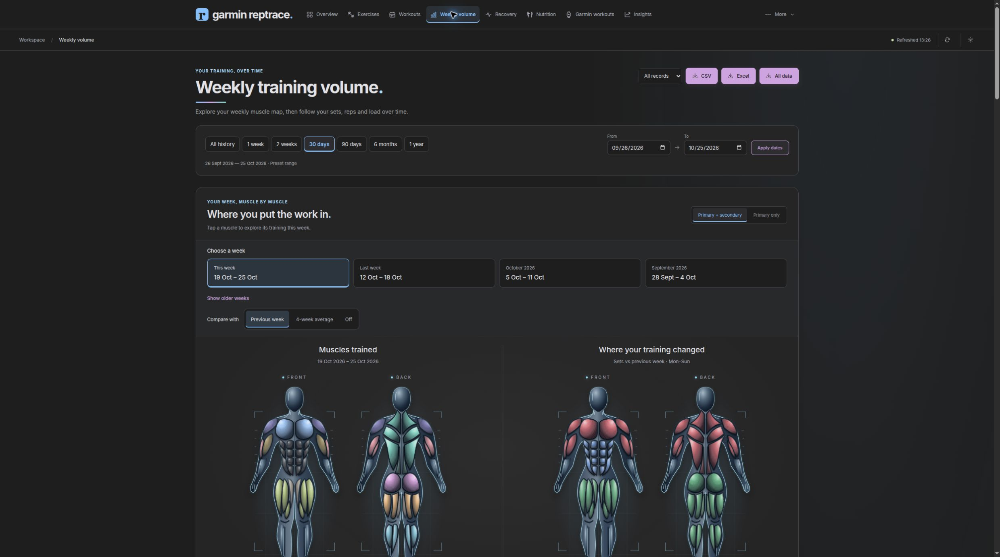
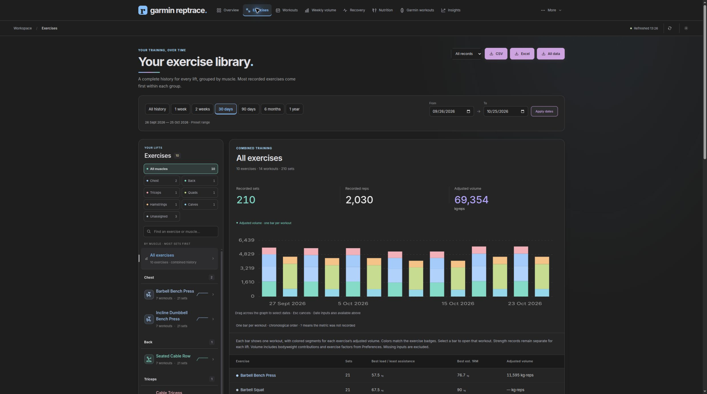
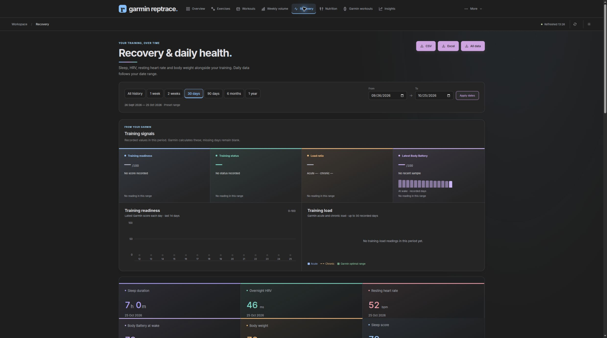
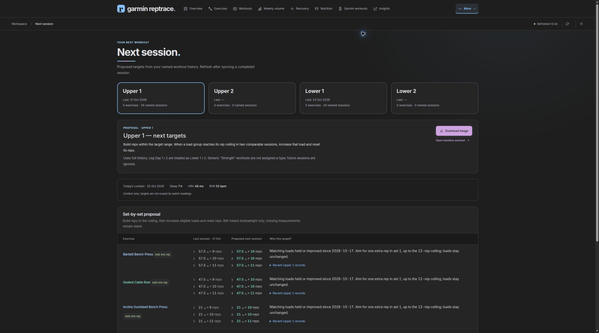

# Garmin RepTrace

Repository name: **`garmin-reptrace`**.

**Your strength, over time.** A self-hosted training app that turns Garmin workouts into exercise-level history, clearer comparisons, and a plan for the next session.

Garmin RepTrace brings sets, reps, loads, recovery, nutrition, and Garmin workout templates into one workspace. It keeps your history on your own server, and includes optional Telegram reports and AI-assisted coaching.



*All screenshots use generated demonstration records, not personal training data.*

[Try the demo](#try-it-without-an-account) · [Install](#install-with-docker) · [Connect Garmin](#connect-garmin) · [User guide](docs/user-guide.md) · [Architecture](docs/architecture.md) · [Upgrade](docs/migration.md)

## Why I built this

Garmin has been a useful way for me to record training, with strong tools for following endurance activities. For strength training, I wanted more detail about how individual exercises were progressing: the loads and reps I used, how sessions compared, which muscles received work, and what to aim for next.

Garmin RepTrace grew from that gap. It combines Garmin collection with a dedicated strength-training application. The aim is to keep the convenient Garmin tracking workflow while making the resulting strength history easier to understand and use.

The app was previously called **Form**, then **RepTrace**. **Garmin RepTrace** is its standalone identity; Garmin collection remains integrated. See [attribution](NOTICE.md) for its origins.

## What you can do

| Area | Capabilities |
| --- | --- |
| Training overview | Workout calendar, recorded sets/reps, recent sessions, recovery and Garmin training signals |
| Exercise history | Load, reps, estimated 1RM, volume, set logs, date/source filters, consistent muscle colors |
| Weekly volume | Stacked exercise contributions, interactive muscle map, week comparisons, missing-input coverage |
| Workout analysis | Detailed sessions, matching-rep comparisons, personal records, descriptive progress and plateau signals |
| Planning | Evidence-based next-session proposals, equipment increments, rep ranges, printable PNG plans |
| Garmin workouts | Browse templates, edit steps/repeats/rest/weights, preview changes, apply and read back the result |
| Corrections and goals | Manual logging, reversible corrections, revision checks, goals with archive/restore |
| Recovery | Sleep, HRV, resting heart rate, Body Battery, body weight, dated readings and explicit gaps |
| Nutrition | Food log, calorie/protein summaries, optional photo/text estimates through Telegram |
| Exports | Filtered CSV/Excel, complete training-data workbook, workout sheets, HTML reports |
| Telegram, optional | Private-owner bot, training plans, weekly/monthly reports, after-workout reports, conversational tools |
| Appearance | Four themes, overview customization, keyboard controls, persistent browser preferences |

Garmin health collection also retains the inherited endurance and intraday datasets.

## A look around

### Follow each exercise



See the actual recorded sets behind a trend. Date and source filters stay consistent across the training views; missing measurements remain missing.

### Put recovery beside training



Look at sleep, HRV, resting heart rate, Body Battery and weigh-ins alongside workouts. Recorded Garmin signals are displayed with their dates; Garmin RepTrace does not invent a readiness score.

### Prepare the next session



Review proposed loads and rep targets against earlier sessions, adjust equipment increments, and download a workout sheet. Proposals are suggestions, never automatically logged as completed workouts.

[Open the visual walkthrough](docs/showcase.md) for more screenshots and a short animated tour.

## Try it without an account

Clone the repository first:

```bash
git clone https://github.com/GlebPlakhtii/garmin-reptrace.git
cd garmin-reptrace
```

Requirements: **Python 3.13** and **uv**. From a local clone of this repository:

```bash
uv sync --locked
uv run garmin-reptrace-demo
```

Open **http://127.0.0.1:3002**. The demo generates 48 workouts and 100 days of recovery examples relative to today's date. It uses temporary SQLite files, no InfluxDB, and no Garmin or Telegram connection. Writes and external actions are disabled. Stop it with Ctrl+C.

```bash
uv run garmin-reptrace-demo --empty       # Explore an empty account
uv run garmin-reptrace-demo --port 3012   # Use another localhost port
```

The demo is for exploring the interface; use a normal installation to save workouts, configure persistent settings, or connect integrations.

## Install with Docker

Requirements: Docker Engine with Docker Compose, or Docker Desktop with Compose. Run the following from your local repository checkout. Published container images are not required; Compose builds the app from source.

1. Create local configuration, without replacing an existing `.env`:

   ```bash
   cp -n .env.example .env
   mkdir -p garminconnect-tokens
   ```

2. Edit `.env`. Set `USER_TIMEZONE` to your IANA timezone, such as `Europe/Kyiv`, and use the same zone for `REPORT_TIMEZONE`. The default is UTC. The container runs as UID/GID **1000:1000**; the token directory must be writable by that identity. On Linux, if necessary:

   ```bash
   sudo chown 1000:1000 garminconnect-tokens
   chmod 700 garminconnect-tokens
   ```

3. Build and start the web app and database:

   ```bash
   docker compose up -d --build influxdb strength-web
   docker compose ps
   ```

4. Open **http://localhost:3001**. An empty account is expected until you connect Garmin or add a workout through **More → Log & edit**.

The default stack consists of Garmin RepTrace and InfluxDB 1.11. SQLite stores application settings, goals, nutrition and edit history. Garmin collection and Telegram are opt-in services.

For the same initial setup, `bash easy-install.sh` creates `.env` if absent and starts the default services. It does not download an upstream installer or authenticate to Garmin.

### Connect Garmin

First authenticate interactively so Garmin can request a password and, when needed, an MFA code:

```bash
docker compose run --rm garmin-fetch-data
```

On first successful authentication the collector saves tokens and exits. If tokens already exist, this command can start collecting; stop the foreground process before starting the background service.

```bash
docker compose --profile garmin up -d garmin-fetch-data
```

Tokens persist in `garminconnect-tokens/`. Keep that directory private. The web app mounts it to access Garmin workout templates. This is an unofficial Garmin Connect integration; device capabilities, account data, upstream API changes, and rate limits affect availability.

The collector checks periodically and imports strength sets alongside health records. **Refresh training data** refreshes the app's database view; it does not force the watch to upload. Use **More → Garmin sync** to distinguish watch upload time, collector check time, and the latest reading for each metric.

To backfill strength-set detail for existing activities:

```bash
docker compose run --rm garmin-fetch-data uv run --no-sync garmin-reptrace-backfill \
  --start-date 2026-01-01 --end-date 2026-10-01
```

Backfill dates use UTC and the end date is inclusive. Backfill contacts Garmin and writes records; start with a limited range. See [configuration](docs/configuration.md) for collector options and historical date ranges.

## Daily workflow

1. Record your workout with Garmin, sync the watch, and let the collector import it.
2. Open **Workouts** to check the recorded sets. Use **Log & edit** for corrections or manually recorded sessions.
3. Use **Exercises** and **Weekly volume** to compare exercise progress and the distribution of recorded work.
4. Look at **Recovery** and **Insights** for context; their associations do not establish cause and effect.
5. Open **More → Next session**, review the evidence and equipment assumptions, then export a plan or preview changes to a Garmin template.
6. Track goals and export your history whenever you need a portable copy.

Quick access contains Overview, Exercises, Workouts, Weekly volume, Recovery, Nutrition, Garmin workouts, and Insights. **More** contains Next session, Personal records, Compare workouts, Goals, Log & edit, Garmin sync, and Preferences.

Read the [user guide](docs/user-guide.md) for filters, plans, Garmin edits, nutrition, exports and corrections.

## Optional integrations

### Telegram and AI

Create a dedicated bot through Telegram's BotFather, then put its token in `.env`. Set `TELEGRAM_ALLOWED_USER_ID` to your private owner's numeric ID, or use the secure pairing flow described in [configuration](docs/configuration.md).

```bash
docker compose --profile telegram up -d telegram-bot
```

The bot uses long polling and needs no public inbound port. Commands include `/menu`, `/next`, `/upper1`, `/upper2`, `/lower1`, `/lower2`, `/weekly`, `/report`, `/status`, and `/export`.

Local planning and calculated weekly summaries do not require an AI API key. Conversational coaching, food estimates and AI report commentary require `OPENAI_API_KEY` and model settings supported by your account. Those features send relevant training or food context to the configured external service and may incur API charges. Core web analytics do not require AI.

Automatic reports can send messages once enabled. Review the report switches and timezone before starting the bot. Telegram edits show confirmation controls; uncertain saves retain their request identities for safe retries.

## Data, privacy and limitations

- The default web port is bound to localhost. This is a **single-owner app**, with host/origin checks rather than multi-user authentication. Put authenticated access in front of it before exposing it remotely; do not publish the app or InfluxDB directly to the internet.
- Local storage stays on your host. Garmin sync, Garmin template edits, Telegram and optional AI requests communicate with their respective services.
- Missing and zero differ. Recorded kg × reps, adjusted volume, bodyweight assumptions and assisted exercise conventions remain explicit. Adjusted volume is not measured effort or muscle stimulus.
- Estimated 1RM is limited to supported weighted sets. Matching reps, units and equipment matter when interpreting comparisons. Effort/RIR and warm-up classification are not universally recorded.
- Plans are transparent heuristics based on available history. The current named-session workflow uses Upper 1/2 and Lower 1/2; see the guide for naming and stale-history behavior.
- Reversible edits archive originals and use revision checks, but collector/manual-edit overlap can still race because Influx replacements are not transactional across services.
- InfluxDB **1.x is the supported full-feature setup**. Some inherited collection/read paths support InfluxDB 3; that does not mean every editing, archive or restore workflow is compatible.
- The legacy TSV importer accepts an explicitly reviewed format and optional private correction profile. It is preserved for migration, not advertised as a general-purpose CSV importer. Use the web logger for ordinary manual entry.

## Backups and upgrades

Back up **both** InfluxDB and the application SQLite files, plus Garmin tokens and Telegram state if used. An Excel export is useful for portability but is not a complete service backup. Never commit any of those private backups.

See [operations and backup](docs/operations.md) for consistent backup steps, rollback, health checks and restoration guidance. Existing Form users should read [migration](docs/migration.md) before changing their checkout directory or Compose project name: either can change which named volumes Compose selects.

## Development

```bash
uv sync --locked
bash scripts/check.sh
uv build
```

The checks run Python unittest discovery, Node's native test runner, and `git diff --check`. The frontend uses native ES modules; there is no bundler or separate frontend build command.

- [Architecture and project layout](docs/architecture.md)
- [Development and verification](docs/development.md)
- [Contributing](.github/CONTRIBUTING.md)
- [Publication checklist](docs/publication.md)

## License and credits

Licensed under **GNU AGPL v3 only (`AGPL-3.0-only`)**. Commercial and non-commercial use are allowed.

When distributing a covered version, comply with the AGPL source-sharing terms.
If you modify the app and let people interact with it over a network, prominently
offer those users the Corresponding Source of that version at no charge. These
obligations apply to commercial and non-commercial deployments; simply selling a
service is not the only trigger. Sharing source means the covered application,
not users' private training records or credentials.

See the full [LICENSE](LICENSE) and [GNU's AGPL explanation](https://www.gnu.org/licenses/why-affero-gpl.html).
Retain the upstream BSD notices in [LICENSES/BSD-3-Clause.txt](LICENSES/BSD-3-Clause.txt).

Garmin RepTrace builds on [Garmin-Grafana](https://github.com/arpanghosh8453/garmin-grafana) by Arpan Ghosh and its Garmin/InfluxDB collection work. See [NOTICE.md](NOTICE.md). Garmin RepTrace is independent and is not affiliated with or endorsed by Garmin.
