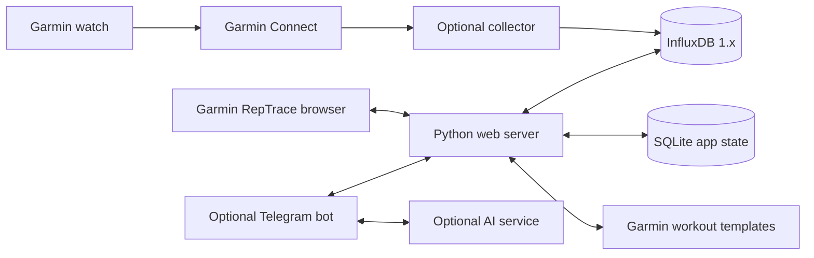

# Architecture

Garmin RepTrace is a self-hosted, single-owner application. The web frontend talks to its
Python HTTP server; database credentials and Garmin tokens stay on the server.



## Source map

| Path | Responsibility |
| --- | --- |
| `src/reptrace/web/server.py` | HTTP assets, validation, data/cache, actions and exports |
| `src/reptrace/storage/state.py` | SQLite state, revision checks, audit history, reversible Influx edits |
| `src/reptrace/web/static/` | Native JS modules, hash routes, SVG charts and muscle map, themes |
| `src/reptrace/training/strength.py` | Garmin strength normalization and measurement semantics |
| `src/reptrace/training/planning.py` | Progression proposals and evidence |
| `src/reptrace/garmin/workouts.py` | Template editing, preview/apply/readback and snapshots |
| `src/reptrace/garmin/collector.py` | Inherited Garmin health/activity collector |
| `src/reptrace/telegram/bot.py` | Owner-restricted bot and report scheduling |
| `src/reptrace/coaching/` | Conversational tools and proposed edits |
| `src/reptrace/reports/` | Calculated facts, HTML and image reports |
| `src/reptrace/exports/sessions.py` | Excel snapshots using packaged templates |
| `src/reptrace/web/demo.py` | Synthetic, read-only showcase with no external connections |
| `tests/unit/`, `tests/frontend/`, `tests/integration/` | Feature-grouped Python tests, native Node tests, opt-in real-Influx checks |

## Storage and compatibility

Influx stores strength sets, activity summaries, daily health readings, collection
markers, and archived versions of edited records. SQLite stores settings, goals,
food entries, request/revision state, and audit information. Garmin template edits
have their own SQLite store. The Telegram service keeps owner and scheduling state
in its own persistent directory.

Existing `/var/lib/form` paths and Compose service/volume keys remain intentional
compatibility details. Changing a product name should not orphan a user's data.
`FORM_API_URL` also remains supported as the bot's API setting.

Web writes are serialized across workers. The collector does not share that lock;
Influx replacement is not transactional, so cross-service overlap remains a known
limit. Revisions and archives reduce risk but do not eliminate this race.

## Design choices

Native browser modules and a Python standard-library server keep the stack small
and make it possible to trace a chart back to its calculation. There is no frontend
build chain. Business rules live in shared model/planning modules, so plans,
charts, exports and reports can use consistent semantics.

Historical source measurements are preserved. Display adjustments are labeled;
unknown values stay unknown. The application separates planning, completed work,
and external template updates rather than treating a suggestion as a performed set.

## Package layout and dependency boundaries

```text
src/reptrace/
├── __init__.py              # Package identity; no startup side effects
├── __main__.py              # python -m reptrace
├── web/                    # HTTP server, isolated demo, static frontend
├── training/               # Strength normalization, metrics, planning, equipment
├── storage/                # App state, read queries, reviewed manual import
├── garmin/                 # Collector, backfill, workout template adapter
├── nutrition/              # Food estimation and nutrition history
├── coaching/               # Conversational tools and confirmed edit drafts
├── reports/                # Weekly/monthly facts and report rendering
├── exports/                # Excel, images, Influx export, workbook templates
└── telegram/               # Bot orchestration and message formatting
```

Training calculations do not depend on web handlers or bot delivery. Shared
missing-aware numeric helpers live in `training.metrics`; nutrition no longer
imports report generation just to sum measurements. Web and Telegram assemble
these capabilities at the application boundary. Persistence still supplies
revision/conflict semantics to operations that need them.

Imports use explicit package paths. The old direct-file `ImportError` fallbacks
are removed; use the installed CLI or `python -m` entry points. This avoids
masking missing dependencies as a script-path fallback. Static browser URLs stay
unchanged even though assets now live under `web/static/`. Excel templates live
beside their exporter under `exports/templates/`.

The collector and raw Influx exporter are safe to import. Collector configuration,
logging setup, database initialization, authentication and polling run only from
its explicit entry point. Import safety is tested without contacting services.

The collector, Telegram bot, storage implementation and frontend application are
still substantial modules. This refactor establishes ownership and removes
startup/import hazards; it does not rewrite their behavior or split transactional
workflows across arbitrary files. The collector's legacy runtime configuration
still uses module globals inside its dedicated package.
