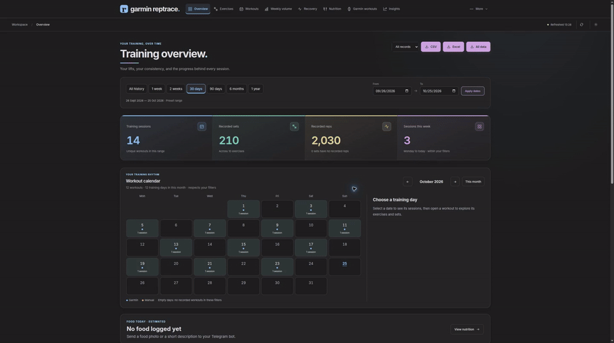
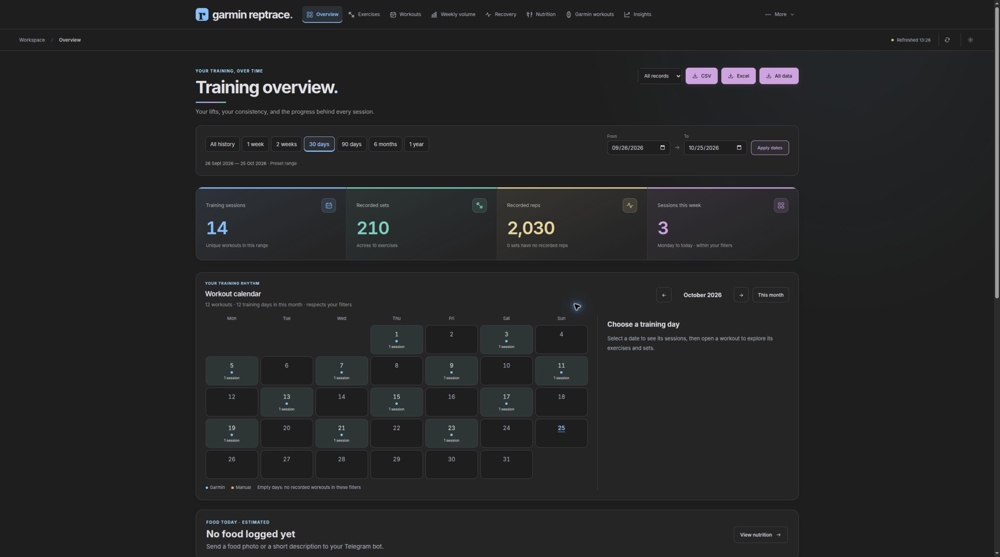
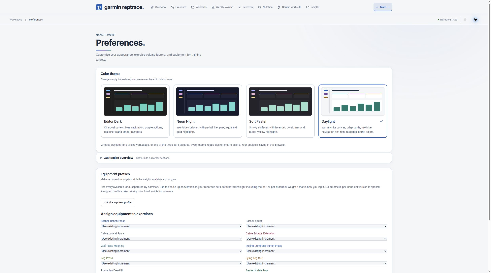

# Garmin RepTrace visual walkthrough

These are screenshots of the real application running `uv run garmin-reptrace-demo`.
All records are synthetic. The tour is a screenshot slideshow, not a recording of
live Garmin sync or a claim that external actions were performed.

[Play/download the 20-second MP4 tour](media/garmin-reptrace-tour.mp4)

## Overview

Training consistency, recent sessions and dated recovery context in one workspace.

## Exercises

Inspect the recorded sets behind the charts and compare exercise contributions.

## Weekly volume

Explore muscle groups, compare weeks and keep secondary involvement separate from
unique all-muscle set totals. These colors describe recorded work, not measured stimulus.

## Recovery

Sleep, HRV, resting heart rate, Body Battery and weigh-ins with explicit gaps.

## Next session

Review the prior results, proposed targets and reasons before using a plan.

## Reproduce the screenshots

1. Run `uv sync --locked` and `uv run garmin-reptrace-demo`.
2. Open http://127.0.0.1:3002 in a desktop browser.
3. Capture the named pages with the default dark theme. Scroll Weekly volume to
   include the complete body map and comparison labels.
4. Keep the navigation visible and use only generated data. The default date
   range is 30 days; demo dates move with today.
5. Run `bash scripts/build_showcase.sh` to rebuild the slideshow from these JPEGs.

No Garmin credentials, account identifiers, or real workout histories are used.

## Daylight theme

The same interface also has a light theme, selected in Preferences and remembered
in the browser. This screenshot uses a populated synthetic account.

